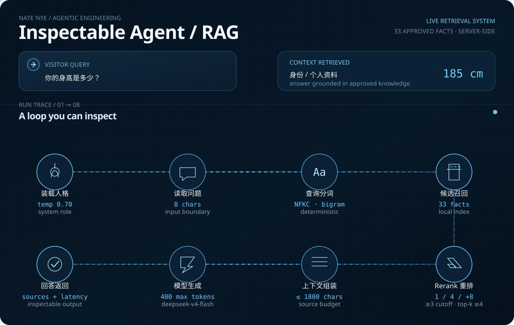

<table>
<tr>
<td width="30%" valign="top" align="center">

### Nate Nye

**聂弈楠**

Electronic and Computer Engineering  
Shanghai Jiao Tong University

`Agent systems` `RAG` `interactive web`

</td>
<td width="70%" valign="top">

</td>
</tr>
</table>

I build agent systems that make their execution inspectable: **retrieval**, **reranking**, **tool boundaries**, **latency**, and **verification** are part of the interface, not hidden implementation detail.

[Personal site](https://natricknye.cn/) · [Live agent](https://natricknye.cn/#chat) · [GitHub](https://github.com/natricknye)

### Selected work

- **Nate Nye / Personal Observatory** — a bilingual portfolio with a Three.js globe, Canvas physics, and an inspectable RAG agent. [Open the site](https://natricknye.cn/)
- **SJTU Model United Nations** — technical lead and developer of the official bilingual conference platform, serving 200+ users. [Visit the site](https://sjtumuna.sjtu.edu.cn/)
- **Dela** — merged open-source fix for Windows command bridging and Chinese encoding. [View the contribution](https://github.com/Chang-Yo/Dela/pull/145)

Currently exploring local-first campus agents, retrieval evaluation, and interaction design for AI systems.
