I build agent systems that make their execution inspectable: **retrieval**, **reranking**, **tool boundaries**, **latency**, and **verification** are part of the interface.

[Personal site](https://natricknye.cn/) · [Live agent](https://natricknye.cn/#chat) · [GitHub](https://github.com/natricknye)

### Selected work

- **Personal website** — a bilingual portfolio with a Three.js globe, Canvas physics, and an inspectable RAG agent. [Open the site](https://natricknye.cn/)
- **SJTU Model United Nations** — technical lead and developer of the official bilingual conference platform, serving 200+ users. [Visit the site](https://sjtumuna.sjtu.edu.cn/)

Currently exploring local-first campus agents, retrieval evaluation, and interaction design for AI systems.
