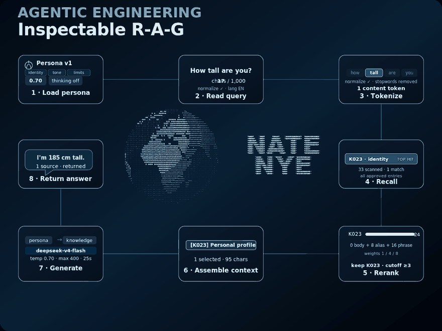

Currently exploring **Campus Agents**, **Retrieval-Augmented Generation**, **Interaction Design**, and **Recursive Self-Improvement** for AI systems.

[Personal Site](https://natricknye.cn/) · [Live Nate Agent](https://natricknye.cn/#chat) · [GitHub Profile](https://github.com/natricknye)

### Selected work

- **Personal Website of Nate Nye** — a bilingual portfolio with a Three.js globe, Canvas physics, and an inspectable RAG agent. [Visit the site](https://natricknye.cn/)
- **SJTU Nanyang Model United Nations Conference Website** — technical lead and developer of the official bilingual conference platform, serving 200+ users. [Visit the site](https://sjtumuna.pages.dev/)

